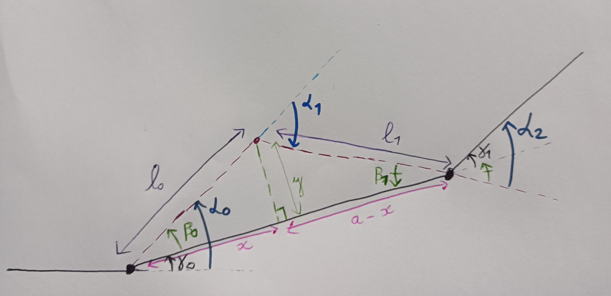

# Virtual support angle calculation

This graph is the view from above.

The solid black lines: the original spans

The dashed red lines: new line with the new added virtual support

Black points: original supports

Red point: virtual support

## Input data

$a$: original span length

$x$ : longitudinal distance of the virtual support from the original left support(same `x` than in the call of `set_virtual_support()`)

$y$ : lateral distance of the virtual support from the line (same `y` than in the call of `set_virtual_support()`). Can be negative

$\gamma_0$, $\gamma_1$ : original line angles

$\beta_0$, $\beta_1$, $\beta_2$ : intermediate angles for computation: angles of the triangle made by the virtual support.

## Values to be computed

$\alpha_0$, $\alpha_1$, $\alpha_2$ : new line angles with added virtual support

$d_0$, $d_1$: new span lengths with added virtual support

## Angles

$$\beta_0 = arctan(\frac{y}{x})$$

$$\beta_1 = arctan(\frac{y}{a - x})$$
 
$$
\begin{aligned}
  \alpha_0 & = \gamma_0 + \beta_0 \\
           & = \gamma_0 + arctan(\frac{y}{x})
\end{aligned}
$$

$$
\begin{aligned}
  \alpha_1 & = - (\pi - \beta_2) \\
           & = (\pi - \beta_0 - \beta_1) - \pi \\
           & = - (\beta_0 + \beta_1)
\end{aligned}
$$

$$
\begin{aligned}
  \alpha_2 & = \gamma_1 + \beta_1 \\
           & = \gamma_1 + arctan(\frac{y}{a - x})
\end{aligned}
$$

## Distances

Just using Pythagoras:

$$
d_0 = \sqrt{x^2 + y^2}
$$

$$
d_1 = \sqrt{(a-x)^2 + y^2}
$$
